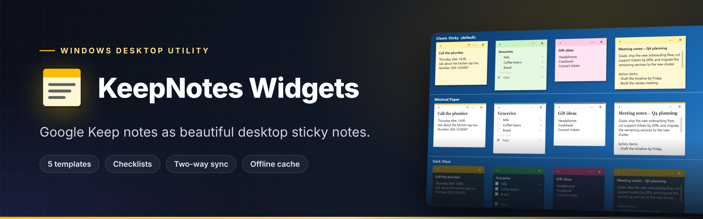
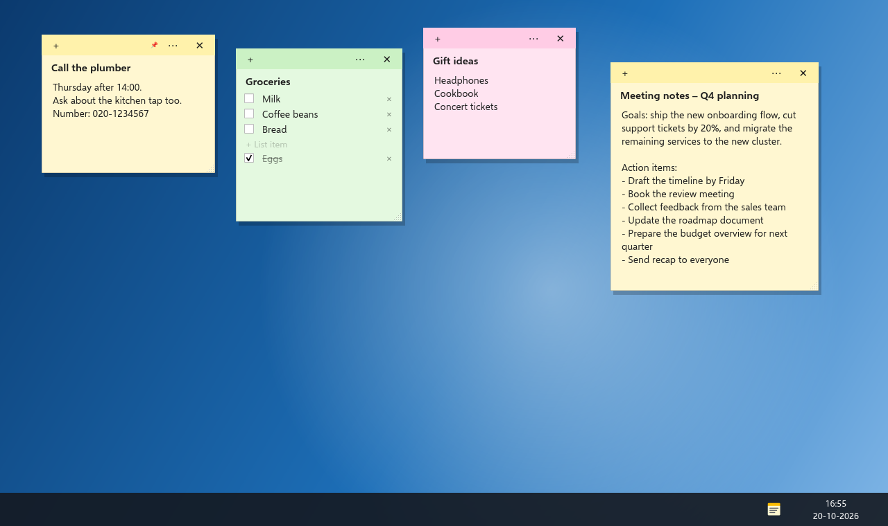
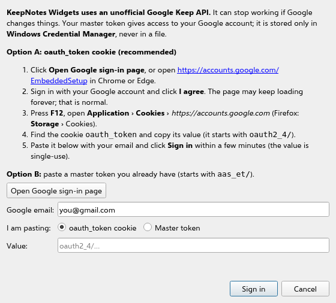
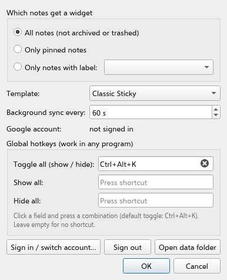
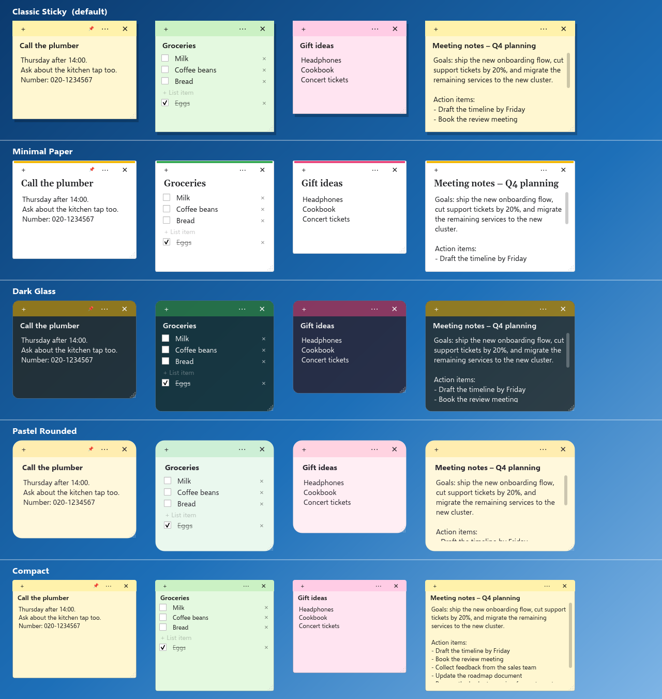

  

  
  
  
  
  

<h3 align="center">Your Google Keep notes and checklists as Sticky Notes-style widgets on the Windows desktop — edit them there, and they sync back to Keep.</h3>

  <a href="#-quick-start">Quick start</a> ·
  <a href="#-features">Features</a> ·
  <a href="#-templates">Templates</a> ·
  <a href="#%EF%B8%8F-hotkeys">Hotkeys</a> ·
  <a href="#-configuration">Configuration</a> ·
  <a href="#-faq--troubleshooting">FAQ</a> ·
  <a href="#-roadmap">Roadmap</a> ·
  <a href="#-pro--coming-soon">Pro</a>

---

## ✨ Features

<table>
<tr>
<td width="33%" valign="top">

### 🗒️ One widget per note
Every Keep note becomes its own desktop sticky — titles, text and checklists, in Keep's colours.

</td>
<td width="33%" valign="top">

### 🔄 Two-way sync
Edit on the desktop and it lands in Keep; edit on your phone and the widget updates. Background sync every 60 s and ~2 s after each edit.

</td>
<td width="33%" valign="top">

### 🎨 5 templates
Classic Sticky, Minimal Paper, Dark Glass, Pastel Rounded and Compact — switch live, with instant preview.

</td>
</tr>
<tr>
<td valign="top">

### ✅ Real checklists
Tick items, add new ones with Enter, delete with ✕. Checked items sink to the bottom with a strike-through, just like Keep.

</td>
<td valign="top">

### 📴 Offline cache
Notes stay visible and editable without a connection. Unsynced edits survive restarts and upload when you're back online.

</td>
<td valign="top">

### 🎯 Choose what you see
All notes, only pinned notes, or notes with one label — keep the desktop as tidy as you like.

</td>
</tr>
<tr>
<td valign="top">

### ⌨️ Global hotkeys
**Ctrl+Alt+K** shows or hides all notes from any program.

</td>
<td valign="top">

### 🔐 Credential Manager
Your Google login token is stored only in **Windows Credential Manager** — never in a file or log.

</td>
<td valign="top">

### 📌 Desktop-native
Drag, resize, pin, colour and keep on top per note. Positions are remembered across restarts.

</td>
</tr>
</table>

## 📸 Screenshots

<table>
<tr>
<td align="center" width="50%"> Guided sign-in</td>
<td align="center" width="50%"> Notes filter, template, sync and hotkeys</td>
</tr>
</table>

> All screenshots use demo data.

## 🎨 Templates

**Settings → Template** restyles every note instantly (the drop-down previews live; Cancel undoes it). Note colours work in every template.

| Template | Look |
|---|---|
| **Classic Sticky** (default) | The familiar Windows Sticky Notes look |
| **Minimal Paper** | White paper, thin border, serif title, a thin colour line on top |
| **Dark Glass** | Dark, slightly translucent notes with rounded corners and a tinted header |
| **Pastel Rounded** | Large rounded corners and soft pastel colours |
| **Compact** | Smaller font and padding — fits many notes on screen |

## 🚀 Quick start

**Requirements:** Windows 10/11 and Python 3.11+ with the `py` launcher (`winget install Python.Python.3.12`).

1. **Download** or clone this repository.
2. **Double-click `install.bat`.** It creates a private `.venv`, installs the pinned dependencies (PySide6-Essentials, gkeepapi, gpsoauth, keyring) and adds a **KeepNotes Widgets** Start Menu shortcut.
   - `install.bat /startup` also starts the app with Windows; `install.bat /quiet` skips all questions.
3. **Start it** from the Start Menu or with **`run.bat`** (no console window).
4. **Connect Google Keep** with the guided sign-in window (see [FAQ](#-faq--troubleshooting) for details).

Prefer your system Python? `py -m pip install -r requirements.txt` and use `run.bat`.
Just want to look around? `run.bat --demo` shows sample notes and syncs nothing.

## ⌨️ Hotkeys

| Action | Default | Where to change |
|---|---|---|
| Toggle all notes (hide if any is visible, otherwise show all) | **Ctrl+Alt+K** | Settings → Global hotkeys |
| Show all notes | — (optional) | Settings → Global hotkeys |
| Hide all notes | — (optional) | Settings → Global hotkeys |
| Add a checklist item | **Enter** in *+ List item* | — |

A shortcut needs two modifiers (e.g. Ctrl+Alt+…), a Win-key combination or F13–F24. Conflicts with other programs are detected and reported in Settings.

## 🛠 Configuration

Tray icon → **Settings…**

| Setting | Options |
|---|---|
| Which notes get a widget | All notes · only pinned notes · only notes with a label |
| Template | Classic Sticky · Minimal Paper · Dark Glass · Pastel Rounded · Compact |
| Background sync | Default every 60 s, plus ~2 s after each edit |
| Per note (⋯ menu) | Colour · pin · always on top · move to trash (with confirmation) |
| Account | Sign in / switch account · sign out |
| Start with Windows | Tray menu toggle (shortcut in `shell:startup`) |

**Files** — all per user:

| Path | Contents |
|---|---|
| `%APPDATA%\KeepNotesWidgets\layout.json` | Widget positions, sizes, colours and settings |
| `%APPDATA%\KeepNotesWidgets\state.json` | Offline note cache (no password or token) |
| `%APPDATA%\KeepNotesWidgets\keepnotes.log` | Log file |
| Windows Credential Manager → `KeepNotesWidgets` | Email + master token |

## ❓ FAQ & troubleshooting

<b>How does sign-in work?</b>

Google no longer accepts a plain password for this API, so the app uses the gpsoauth *oauth_token* flow: open the Google sign-in page from the app, sign in and click **I agree**, then copy the `oauth_token` cookie (F12 → Application → Cookies → accounts.google.com) and paste it with your email. The app exchanges it once for a long-lived master token stored in Credential Manager. Already have a master token (`aas_et/…`)? Paste that instead.

<b>Is the Google Keep API official?</b>

No. Sync uses <a href="https://github.com/kiwiz/gkeepapi">gkeepapi</a>, an unofficial API that Google can change at any time. If it breaks, sync pauses (orange badge on the tray icon) and your cached notes stay usable; edits upload once sync works again.

<b>Ctrl+Alt+K types a character / AltGr behaves oddly</b>

Windows treats **AltGr as Ctrl+Alt**. On layouts such as US-International, a global Ctrl+Alt+K also catches AltGr+K. If you use AltGr for special characters, pick another combination in Settings (e.g. Ctrl+Alt+Shift+K or Win+Alt+K).

<b>Nothing happens when I start the app</b>

Check `%APPDATA%\KeepNotesWidgets\keepnotes.log`. A missing package shows a message box and logs `ERROR Startup failed`. An incomplete `.venv` is skipped — run `install.bat` again or delete `.venv` to use your system Python.

<b>A colour I picked doesn't show up in Keep</b>

gkeepapi has a known issue where colour changes sometimes don't stick in Keep. The widget always remembers your colour locally.

<b>What isn't supported?</b>

Images, drawings, reminders, collaborators and nested checklist items are left untouched in Keep. Archived and trashed notes are not shown.

<b>How do I uninstall?</b>

Quit from the tray and run `uninstall.bat` (removes shortcuts and `.venv`). To remove everything, also delete `%APPDATA%\KeepNotesWidgets` and the `KeepNotesWidgets` entries in Credential Manager. Your notes stay in Google Keep.

## 🗺 Roadmap

- [ ] Image and drawing previews
- [ ] Reminders on the widget
- [ ] Custom user templates
- [ ] Per-monitor layouts
- [ ] Signed single-file installer (no Python required)
- [ ] Auto-update

## 💎 Pro — coming soon

> **Not available yet.** A Pro edition is being planned. Pricing and release date will be announced later.

Candidate Pro features: a signed one-click installer without Python, a template designer, image notes, multi-monitor layouts and priority support. Interested? Watch this repository for updates.

## 📄 License

Proprietary software — **Copyright (c) 2026 GaryHman. All rights reserved.** See [LICENSE](LICENSE).

Google Keep is a trademark of Google LLC. This project is not affiliated with Google.
